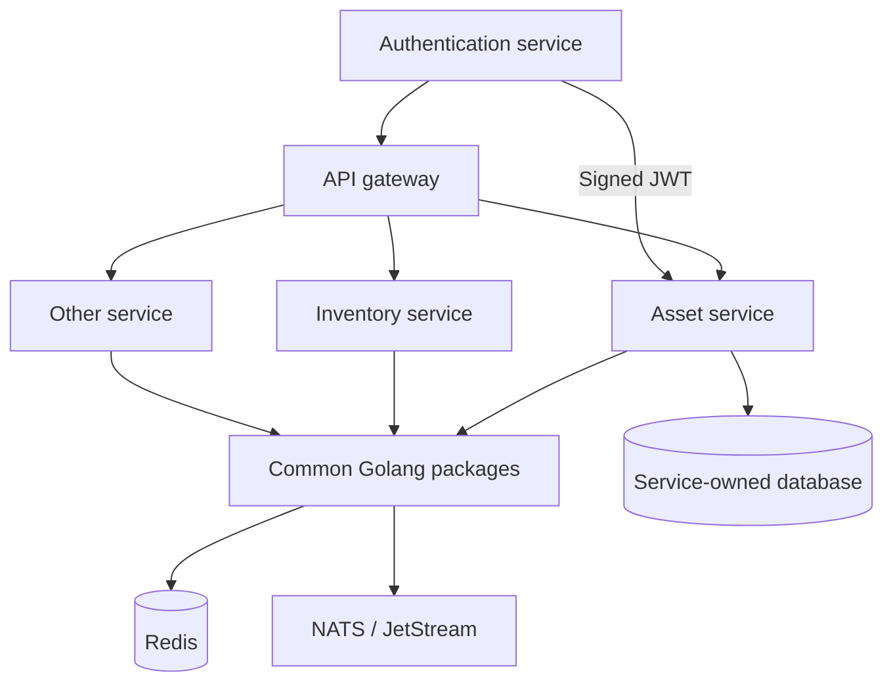

# Architecture and responsibilities

Common Golang is a library, not a service. Services own dependency configuration, application use cases, domain rules, persistence, data ownership, migrations and authorization policy. They initialize only the infrastructure packages they need at their composition root and inject interfaces into their use cases. The library must never import a consuming service.

Illustrative service topology only, not a claim about the existing Asset Management implementation. JWT verification is local using trusted key material. Infrastructure connectors are not mandatory dependencies at runtime for services that do not use them.

## Request flow

RequestID -> AccessLog -> Recovery -> body limit -> Authenticate -> RequireBranch -> RequirePermission -> handler -> use case -> scoped repository. Put logging outside recovery so recovered HTTP failures are logged with the final response code. Request IDs are not authorization credentials. Inbound request IDs are ignored by default; enable reuse only on a trusted ingress which sanitizes them.

Scope is request-level context, not row-level authorization. A branch is selected only from an authenticated principal's allowed branches; tenant comes from the signed claim. Every database read, write, join, unique constraint as appropriate, cache key and event lookup must apply the actual tenant/branch policy. Do not trust `X-Tenant-ID` or accept `X-Branch-ID` without membership verification. A permission string is an exact match; no implicit wildcards or admin bypasses. Claims reflect authorization at issue time: use short TTL and live policy checks for revocation-sensitive actions.

## Messaging guarantees

- Core NATS is best-effort/at-most-once; successful local publish is not a server persistence acknowledgement.
- JetStream durable publication waits for a server ack; `eventID` is reused for retry deduplication within the configured stream window.
- Consumer processing is at least once. Ack only after database commit; handler errors cause delayed NAK. An ack timeout can result in redelivery even after successful processing. Use the V2 PostgreSQL idempotency/outbox primitives when suitable; a dedicated consumer inbox and service-specific authorization are still necessary. No distributed transaction is provided here.
- Stream names, subjects, retention, replica count, consumer MaxDeliver, AckWait and dead-letter policy are service/deployment-specific. Configure them explicitly. MaxDeliver is not an automatic DLQ.
- Handler cancellation is cooperative. Drain or stop and wait for the consume context to close on shutdown; avoid starting work after cancellation and ensure AckWait exceeds processing + acknowledgement budgets.

## Security and operation

Use TLS, Redis ACLs, NATS accounts/subject permissions and separate credentials in production. Redis lease locks use atomic token comparison, but expiration, pauses, failover and partitions may still permit concurrent work; use database transactions/constraints or fencing for correctness-critical asset allocation. Do not use a Redis lease as the sole inventory consistency mechanism.

Use RS256 public-key verification in resource services so they cannot mint access tokens. HS256 is appropriate only where every verifier is also trusted to sign. V2 provides explicit in-process key rotation with a configured key ring. It does not implement JWKS discovery, refresh-token persistence, session revocation or authentication itself. Key rotation and claim contract need coordination with the authentication service. Do not put sensitive PII in JWT payloads. Logs redact selected exact attribute names only; never log token contents, passwords, raw request bodies, sensitive error causes or nested arbitrary objects. Application audit events are separate from diagnostic logs; V2 supplies a minimal transaction-bound audit table.

Readiness checks run concurrently with one in-flight slot per dependency and a response deadline; checks must still honor cancellation and be cheap; liveness never depends on external infrastructure. The HTTP client is intended for trusted, configured upstream URLs, not arbitrary user URLs; it is not a general SSRF guard. No automatic retries on non-idempotent HTTP requests. Production rollout needs dependency/security review and load testing.
